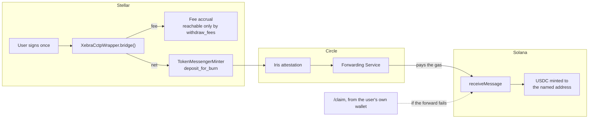

# Xebra


<sub>The 67-second film, looping. [Full quality, 1080p](film/xebra-film.mp4). It shows the first
version, where a relay paid for the mint; Circle's Forwarding Service does that now.</sub>

USDC from Stellar to Solana, Arc and, one by one as the wrapper commits them, fourteen EVM chains;
and from Arc to those fourteen chains and Solana. All over Circle's CCTP. One asset, **mainnet only**.

A user connects a Stellar wallet, enters an amount and an address on the destination chain, and signs once. A
Soroban wrapper contract takes the fee and hands the burn to Circle, with Circle's forwarding hook,
in the same transaction. Circle attests the burn and its Forwarding Service mints on the far side,
paying the gas and taking its delivery fee out of ours. If a forward fails, the transfer is still
claimable by anyone — including the user, from `/claim`.

From Arc, the page calls Circle's `TokenMessengerV2` directly today: no Xebra contract and no Xebra
fee on those routes ([below](#routes-around-arc)). Xebra's EVM fee wrapper is deployed on Arc mainnet
and takes over when it is switched on.

The Stellar wrapper never holds a user's principal. Either the fee is taken and the burn happens in
the same transaction, or the whole transaction reverts and the user keeps every stroop. (The EVM
wrapper does hold it, within one transaction, because Circle's EVM messenger burns from the caller;
see [`SECURITY.md`](./SECURITY.md).)

## Status

| | |
|---|---|
| Wrapper contract | **v2 live on Stellar mainnet** — `CCPVTWII2TW6VVSVA4JQ2KFHICGBG4QVAHPIGUPSIW3E4VNPUI4Y2WQR` ([`deployments/mainnet.json`](./deployments/mainnet.json), `cctpWrapperV2`). v1 (`CCNWLGFM…`) is retired |
| Corridor | Stellar → Solana and Stellar → Arc; Stellar → Base proposed on 2026-10-15 (committable 2026-10-17), Monad next. **Real transfers have completed end to end**, first through v1 and a relay, then through v2 and Circle's forwarder. One burn is unrecoverable forever — see [`writeups/01-the-lost-dollar.md`](./writeups/01-the-lost-dollar.md) |
| Delivery | Circle's Forwarding Service. There is no relay and no hot wallet; a failed forward is claimed by its owner at `/claim` |
| Routes around Arc | Arc → 14 EVM chains and Solana are live. Proven on testnet (2026-10-14); first mainnet transfer Arc → Base on 2026-10-15. EVM chains → Arc is built and switched off |
| Arc fee wrapper | **Deployed on Arc mainnet** — `0x11b30470DAE40B2Fc27b7AA90dc58e6B4fE9f4c3` (`deployments/mainnet.json`, `arcWrapper`), five real transfers through it on Arc testnet. Not used by the page until `NEXT_PUBLIC_ARC_USE_WRAPPER=1` ([`docs/go-live.md`](./docs/go-live.md#turning-on-the-arc-wrapper)) |
| Frontend | **Live** — [xebra-sandy.vercel.app](https://xebra-sandy.vercel.app/) |
| CI | lint, typecheck, `vitest`, `cargo test` and `forge test` on every push |

What is left before someone who is not us can bridge — and which parts need an account, a key or a
decision rather than code — is [`docs/go-live.md`](./docs/go-live.md).

## How a transfer works



Two properties do the load-bearing work when anything goes wrong:

- **`destination_caller` is zero**, so every message is permissionlessly mintable. If this project
  disappears mid-transfer, the burned USDC is still claimable forever by whoever holds Circle's
  attestation. `/claim` is that path, in the browser, from the user's own wallet.
- **The user is `caller` on the burn**, not the wrapper. USDC moves from the user directly to
  Circle, argument-bound by the user's own signature — a fully compromised admin
  cannot redirect anyone's burn, and `withdraw_fees` structurally cannot reach user money.

Both are explained in [`contracts/stellar-cctp-wrapper/README.md`](./contracts/stellar-cctp-wrapper/README.md).

## Routes around Arc

Arc sends to Avalanche, OP Mainnet, Arbitrum, Base, Polygon, Unichain, Codex, Sonic, World Chain,
Monad, Sei, XDC, HyperEVM and Ink, and to Solana. The wallet approves Circle's `TokenMessengerV2`
for the amount and calls `depositForBurnWithHook` with the forwarding hook, so Circle mints on the
destination and takes its delivery fee out of the amount. There is no contract of ours in between
today, so the bounds a wrapper would enforce are applied in the page before signing
(`apps/web/lib/evm-forward-fee.ts`), and every constant is pinned in
`packages/network-config/src/evm-chains.ts` and re-read from the chains by `pnpm check:evm`.

`contracts/arc-evm/src/XebraCctpWrapper.sol` changes that: Stellar's fee (0.10%, 0.30 USDC floor,
Circle's delivery fee paid out of it), the same caps and the same 48-hour governance, enforced on
chain. It is deployed on Arc mainnet and pinned in `XEBRA_WRAPPERS`; with
`NEXT_PUBLIC_ARC_USE_WRAPPER=1` the page approves and calls it instead of Circle.
Ethereum, Linea, Plume and EDGE are left out on purpose.

Two build-time lists switch them on, one direction at a time: `NEXT_PUBLIC_ARC_SENDS_TO` (chain
names, `solana`, or `all`) and `NEXT_PUBLIC_ARC_RECEIVES_FROM` (EVM chains that may send into Arc).
Production is built with `NEXT_PUBLIC_ARC_SENDS_TO=all` and no `NEXT_PUBLIC_ARC_RECEIVES_FROM`.

## Stellar to the EVM chains

The same fourteen chains can be reached from Stellar through wrapper v2, which needs no code change
for them: each chain's CCTP domain is proposed in `/admin`, and committed 48 hours later. The
wrapper holds one pending domain at a time, so they are added one by one. The page reads the
wrapper's committed domains and offers a chain only when it is committed *and* named in
`NEXT_PUBLIC_STELLAR_SENDS_TO` (chain names, or `all`), so a chain appears by itself when its commit
lands. Today it has Solana and Arc; Base is proposed (committable 2026-10-17) and Monad is next.
`pnpm check:evm` reads back, for each chain, that
Circle's contracts know Stellar both ways and that Iris prices forwarding under the cap.

## Repo layout

The corridor — everything on the deployment path:

```
apps/web/                    Next.js frontend (Vercel) and its server routes
  app/                         / bridge · /claim · /admin · /recover · /intent/[hash]
  app/api/                     Circle pre-flight, delivery status, attestation, re-attestation, Solana RPC, recipient, Arc wrapper settings
  convex/                      the shared Iris rate counter (irisBudget)
contracts/stellar-cctp-wrapper-v2/  XebraCctpWrapper v2, live: Circle mints on the destination (84 tests)
contracts/stellar-cctp-wrapper/  v1, retired — fee-taking front door to CCTP V2 (41 tests)
contracts/arc-evm/           XebraCctpWrapper.sol, the Arc fee wrapper, on Arc mainnet (34 Foundry tests);
                               also XebraEscrow.sol, which is not on the deployment path
packages/
  cctp-solana/                 receiveMessage instruction, for /claim
  cctp-evm/                    EVM calldata: receiveMessage for /claim; approve, depositForBurnWithHook and the wrapper's bridge for the Arc routes
  network-config/              pinned mainnet constants + a validator that refuses an incoherent mix; the EVM chain table
  cctp-client/                 Iris client, rate budget, Circle pre-flight, delivery state
  observability/               OTel traces/metrics, wired in through apps/web's instrumentation.ts
scripts/
  deploy-cctp-wrapper-v2.sh    gated v2 deploy (interface check, tests, release build, typed confirm)
  deploy-arc-wrapper.sh        gated Arc wrapper deploy (chain, Circle's messenger, tests, balance, typed confirm)
  arc-wrapper-admin.sh         the Arc wrapper's state, and its governance calls behind a typed yes
  test-arc-wrapper-testnet.sh  one real transfer out of Arc testnet through the wrapper, checked at the recipient
  smoke-prod.sh                read-only check of a deployed app
  check-cctp-interface.sh      our trait vs. the live mainnet Circle contract
  check-arc-cctp.sh            every Arc corridor constant vs. the live chains (read-only)
  check-evm-cctp.sh            every constant the Arc <-> EVM routes rest on vs. the live chains (read-only)
  check-stellar-evm-cctp.sh    what Stellar -> each EVM chain rests on, before its domain is committed (read-only)
  preflight-bridge.mjs         v1-era checks before a Stellar -> Solana burn (still reads the old relayer key)
  recover-stranded-mint.mjs    operator recovery for a v1 burn that named a wallet, not a token account
  cctp-mint-solana.mjs         manual mint, used for the first live transfer
```

Not on the deployment path — the Arc↔Stellar intent/escrow corridor and the self-hosted container
stack. They stay in the repo, and build and test in CI, for anyone who wants to run the container
version; nothing Vercel or Convex serves depends on them being up:

```
apps/            api · solver · arbiter-service · projector · indexer-{arc,stellar,solana}
packages/        intent-schema · router-core · chain-adapters · arbiter-signer · db · event-bus
contracts/       arc-evm (XebraEscrow.sol, 17 tests) · stellar-soroban (14 tests)
infra/terraform  ECS Fargate, RDS, ElastiCache, Redpanda, KMS
docker-compose.yml  anvil, Stellar quickstart, solana-test-validator, Postgres, Redis, Redpanda
```

One live thread between the two: `/intent/[hash]` still reads `apps/api`'s `intentStatus`
procedure, so that page needs the container stack even though the bridge does not.
`lib/open-intent.ts` and `lib/build-open-intent-params.ts` are escrow-rail leftovers no page
imports since the bridge screen was rebuilt around amount and destination alone.

## Getting started

```bash
pnpm install
cp .env.production.example .env.production   # public mainnet constants; never a secret
pnpm --filter @xebra/web dev
```

`pnpm dev` points the UI at real money. Browsing is safe — quotes are Soroban simulations and
nothing moves until a signature — but a signed transaction spends real USDC.

Without Convex the app still runs, and counts its calls to Circle's Iris API per instance. To use
the shared counter, give it a Convex deployment of your own. Convex bundles `@xebra/cctp-client`
from its `dist/`, so build it first:

```bash
pnpm --filter @xebra/cctp-client build
cd apps/web && npx convex dev
```

### Commands

| | |
|---|---|
| `pnpm lint` / `pnpm lint:fix` | Biome over the whole repo |
| `pnpm typecheck` | every workspace package |
| `pnpm test` | vitest, plus the Rust and Foundry suites |
| `pnpm test:contracts` | `cargo test` and `forge test` only |
| `pnpm check:env` | no secrets in env files, correct tracking, coherent config, client-bundle hygiene |
| `pnpm check:cctp` | our CCTP trait against the live mainnet Circle contract |
| `pnpm check:arc` / `pnpm check:evm` | the Arc, Arc <-> EVM and Stellar -> EVM route constants against the live chains |
| `pnpm build` | `apps/web` writes to `.next-build`, so a build cannot wipe what `next dev` is serving |

`contracts/*/lib/` is git-ignored and holds no submodules, so Foundry dependencies are installed
per checkout — CI pins them itself. `convex/_generated/` is committed, which is what lets the repo
typecheck before anyone has run `npx convex dev`.

## Deployment

Two services, both with free tiers: **Vercel** serves the UI and its server routes, **Convex**
holds one counter that keeps our calls to Circle's Iris API under its rate limit. No AWS, no
Docker, no Redis, no Kafka, no Postgres.

There is no relay and no hot wallet. Before anyone signs, the page asks `/api/circle-health` and
will not start a transfer while Circle's fee quote or attestation keys look unhealthy; after the
burn, the receipt reads Circle's forward state from `/api/delivery` and sends the owner to `/claim`
if it failed.
`scripts/smoke-prod.sh` checks a deployed app, read-only. Mechanics, environment variables and
costs are in [`docs/deploying.md`](./docs/deploying.md).

## Tech stack

| Layer | Choice | Why |
|---|---|---|
| Monorepo | pnpm workspaces + Turborepo | task-graph caching across small TS packages and non-JS contract packages |
| Contract | Rust + `soroban-sdk` | native `require_auth`, no bespoke signature scheme |
| Frontend | Next.js App Router on Vercel | server routes host what the browser must not do itself |
| Wallet | one modal: Stellar Wallets Kit (Freighter), EIP-6963 for EVM, Wallet Standard for Solana | no wagmi; the EVM routes talk to the wallet's EIP-1193 provider directly |
| Rate counter | Convex | one counter shared by every serverless instance |
| Config | `@xebra/network-config` | one pinned mainnet preset, cross-validated; every address read from the live chain |
| Lint/format | Biome | single fast binary, replaces ESLint + Prettier |
| Tests | vitest · `cargo test` · `forge test` | one CI job per toolchain |

## Docs

| | |
|---|---|
| [`docs/go-live.md`](./docs/go-live.md) | What had to happen before launch, split by who can do it, and what is still open |
| [`docs/deploying.md`](./docs/deploying.md) | Vercel + Convex mechanics, environment variables, costs |
| [`docs/environments.md`](./docs/environments.md) | Mainnet-only config, what is enforced, secrets handling |
| [`docs/forwarding-wrapper.md`](./docs/forwarding-wrapper.md) | The v2 wrapper: Circle mints on the destination, so nobody holds destination gas. Live on mainnet |
| [`docs/admin-panel.md`](./docs/admin-panel.md) | `/admin`: reading and changing the v2 wrapper from a browser wallet |
| [`docs/roadmap.md`](./docs/roadmap.md) | What comes after the USDC corridor: compliance-preserving RWA bridging |
| [`docs/GOVERNANCE.md`](./docs/GOVERNANCE.md) | Admin/pauser roles, the 48h timelock, why pausing skips it |
| [`SECURITY.md`](./SECURITY.md) | Scope, what's worth reporting, how to report it privately |
| [`CONTRIBUTING.md`](./CONTRIBUTING.md) | Setup, checks to run before a PR, what's on the deployment path |
| [`contracts/stellar-cctp-wrapper/README.md`](./contracts/stellar-cctp-wrapper/README.md) | Fee model, decimals, the no-custody invariant, residual risks |
| [`docs/architecture.md`](./docs/architecture.md) | The original two-rail v2 design. Written before the build; the Postgres/Kafka/ECS stack it describes is the self-host path, not what deploys |
| [`xebra-spec_051150 (1).md`](<./xebra-spec_051150 (1).md>) | Corridor 1 (Arc → Stellar), spec frozen |

## License

[Apache 2.0](./LICENSE).
